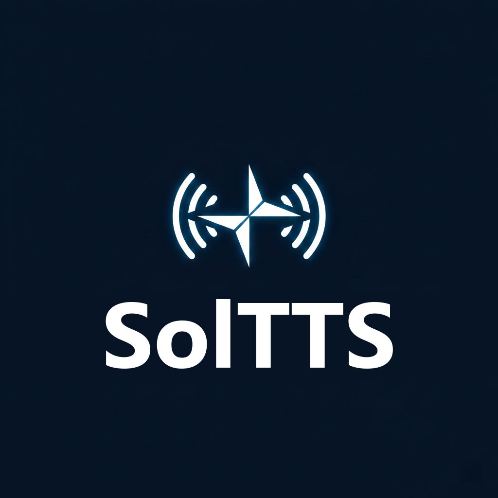

# SolTTS

<p align="center">
  
</p>

<p align="center">
  <strong>🎙️ 一个跑在 .NET 里的本地 TTS 引擎，运行时不需要 Python</strong>
</p>

<p align="center">
  <a href="README.md">English</a> ·
  <a href="https://github.com/YRwuhu/SolTTS/releases">下载</a> ·
  <a href="docs/EMOTION_CONTROL.md">情感控制</a>
</p>

---

## 这是什么

一个文本转语音的服务端 + 命令行工具。给它文字，它给你音频。整个推理跑在 ONNX Runtime
上，运行时不需要 Python、PyTorch 或 conda。

支持用几秒钟的参考录音克隆音色、中英/中日混读、流式播放，以及（实验性的）不需要情感
参考音频的情感引导。

**这是一个 fork。** 原作者 Blackwood416 的项目地址已经失效，这里保留了 v1.2.2 的代码，
并在其上做了一批有实测数据支撑的性能与稳定性改动，下面会写清楚哪些有用、哪些没用。

---

## 快速开始（Windows）

1. 从 [Releases](https://github.com/YRwuhu/SolTTS/releases) 下载 `SolTTS-v1.2.2-win64.zip`。
2. 解压到任意目录，注意 `resources/` 文件夹要和 exe 放在一起。
3. 运行 `sol-server.exe`，浏览器打开 <http://localhost:5000>。
4. 或者直接用命令行合成一个文件：`sol-cli.exe -O out.wav -- "今天天气真好。"`

不需要装 .NET，包是自包含的。

### Linux / macOS

请从源码构建（见下文）。Linux 包没有内置 Python 模型转换环境，需要转换功能时先跑一次
`./init-env.sh`。macOS 版本只支持 V1 引擎。

---

## 速度到底怎么样

测试环境：Ryzen 5 5500（6 核 12 线程）+ Radeon RX 5500 XT。下面都是中位数，不是挑出来
最好看的一次。

| 场景 | 耗时 |
|---|---|
| 单句短文本（约 4 秒音频） | 约 2.0 秒 |
| 三句话，非流式 | 约 2.2 秒 |
| 三句话，流式，到首包 | 约 0.55 秒 |
| 模型加载（冷启动） | 约 7 秒 |

单句里大约 85% 的时间花在自回归语义解码上：约 95 步，每步 11–15 毫秒。这个开销**不是**
内存带宽（早期笔记里写错了）：ORT 自己的算子分析显示，一步里 37% 是 `DynamicQuantizeMatMul`、
39% 是 `Transpose`/`Concat`/`Reshape`/`Unsqueeze` 这类布局算子，而且线程数怎么调都没有
可测量的差别。GPU 卸载也救不了，见[性能笔记](#性能笔记)与
[docs/DECODER_BASELINE.md](docs/DECODER_BASELINE.md) 里的实测数据。

---

## 功能

- **音色克隆** —— 几秒钟的参考音频即可。
- **流式输出** —— 到首包约半秒。
- **混合语种** —— 一句话里中英、中日混读。
- **情感引导**（实验性）—— 往说话人嵌入里注入方向向量，可以调开心/生气/难过等语气，
  不需要情感参考音频。见 [docs/EMOTION_CONTROL.md](docs/EMOTION_CONTROL.md)。
- **WebUI** —— 音色管理、模型转换、参数调节。
- **并发请求** —— 内置推理池。
- **GPU 声码器** —— 通过 ggml/Vulkan 插件，加载失败会自动退回 CPU。

---

## 性能笔记

这一节记录做过什么、结果如何。负面结论也留着，免得有人再踩一遍。

### 有用的

| 改动 | 效果 |
|---|---|
| 声码器上 GPU（ggml/Vulkan） | vits kernel 约 5 倍；非流式端到端约 25%，流式约 2 倍 |
| 跨句并行解码（`ParallelSentenceDegree: 3`） | 三句：约 3.5 秒 → 约 2.4 秒 |
| 流式跨句重叠 | 上一句还在声码器时，下一句已经开始解码；流式总时长约 -10% |
| `VocoderRetriggerFactor: 4.0` | 声码器调用次数 56 → 42；声码器耗时 -29%；流式总时长约 -10% |
| BERT 特征缓存 | 重复文本省掉一次约 280–390 毫秒的前向 |
| Rust 原生音频（`sol_audio`） | 音频管线 p99 27 微秒 → 4 微秒；环形缓冲区 0.70 → 0.05 微秒 |
| `GraphOptimizationLevel: 2` | ORT 把解码器从 1300 节点融合到 696（`DynamicQuantizeMatMul`、`SkipLayerNormalization`、`FusedMatMul`）；95 步完整 rollout token 序列一致 |
| 原生 KV 布局（`UseNativeKvLayout`，默认开） | 解码器布局算子 369 → 273 节点，**每步 1.07–1.13 倍**。logits 与合成音频**逐位相同**。需要对每个资源目录跑一次 `tools/converter/fuse_kv_layout.py`；生成文件缺失时自动回退到原模型 |

### 没用的

| 尝试 | 结果 |
|---|---|
| 给解码器做 INT8 量化 | 模型本来就是 INT8（`MatMulInteger` + `DynamicQuantizeLinear`） |
| BERT 上 GPU | **慢 1.7 倍**（294 → 489 毫秒）。插件直接拒绝这张图："1089 个节点里有 22 个用到了本提供器不支持的算子：Gelu" |
| 解码器 ggml `partial` 卸载 | 14.63 毫秒/步 vs CPU 的 15.71 毫秒，只快 7%，不值得多占显存 |
| 把解码步合并成一个 ONNX `Loop` | 1.02 倍 / 0.98 倍，在噪声范围内 |
| 缩短解码器的 `iy` 输入 | 从 109 个 token 截到 2 个，耗时没变（15.36 → 15.25 毫秒/步） |
| 增量声码（只解码新增 token） | 做不到：VITS 的 `enc_p` 注意力和 flow 依赖整段序列 |
| 用量化矩阵乘的 `QLinearMatMul` 融合 | 否决：它输出 int8，但 int32 累加器范围是 ±20000，会饱和丢精度 |
| 手写 QKV `Split` 融合 | 多余：GOL=2 时 ORT 自己做同样的融合，两个模型都优化成 696 节点。脚本保留，仅 GOL 0/1 时有用 |
| macOS 上的 CoreML | 对这些模型比 CPU 还慢 |
| 解码器整图 ggml 卸载 | 可达（把 2 个 `ArgMax` 改写成 `TopK`，插件就认领 1301/1301 节点、147.6 MiB 权重常驻），但实测 **0.2–0.3 倍**：每步 25–43 毫秒，CPU 是 8–12 毫秒 |
| ORT 线程 / 内存池 / spinning 全组合 | 没有任何一项超出噪声；`IntraOpNumThreads` 8 和 12 反而更慢 |
| 卸载后用 `weights=q8_0` | 能压低 flush（kv=32 时 13.1 → 9.4 毫秒），但仍然打不过 CPU |

说句实话：解码器一步的瓶颈是**节点数和布局**，不是那 72 MB 权重。37% 是
`DynamicQuantizeMatMul`，39% 是纯粹为迁就导出格式而存在的
`Transpose`/`Concat`/`Reshape`/`Unsqueeze`；线程数没用，因为根本没有带宽可压。把图搬到
GPU 只是把同样的逐节点开销搬到一个还要每次重建图的地方，所以只会更慢。真正值得做的是
把每层那 48 条 KV `Reshape`+`Transpose` 链折掉、并减少导出器产生的量化矩阵乘数量，详见
[docs/DECODER_BASELINE.md](docs/DECODER_BASELINE.md)。

---

## 引擎对比

默认用 V1，上面的数据也都是 V1 测的。V2 的代码在，但**随包跑不起来**——没有 `models_v2`
模型文件，也没有 V2 的转换器。

| | V1（推荐） | V2（实验性） |
|---|---|---|
| 来源 | Genie-TTS 架构 | GPT-SoVITS-Minimal |
| 状态 | 稳定 | 未完成，且没有随包模型 |
| 语种 | 中英 / 中日 | 中英 |
| 采样 | 确定性 | TopK / 温度 |
| 情感控制 | 有 | 无 |
| GPU 声码器 | 有 | 无 |
| 并行句 / 流式重叠 | 有 | 无 |

想要速度就用 V1。补齐 V2 最好也就是追平 V1，因为它的解码循环每生成一个 token 就要克隆
整个 KV cache。

---

## 配置

全部在 `config.yaml` 里。真正影响性能的只有几项：

```yaml
ResourcesDir: "./resources"
DefaultAvatarId: chenxing

# 非流式请求的并行解码句数，1 表示关闭
ParallelSentenceDegree: 3

# 流式声码器的重触发策略。调高 = 重算更少 = 更快，
# 但两次音频更新之间的间隔会变长
VocoderRetriggerFactor: 4.0

# GPU 声码器（ggml/Vulkan），插件缺失时自动退回 CPU
UseVocoderGgml: true

# 使用原生 KV 布局的解码器（需先用 tools/converter/fuse_kv_layout.py 生成）。
# 解码循环约 1.07-1.13 倍；文件不存在时回退到原模型。
UseNativeKvLayout: true

# ONNX Runtime 线程数，0 表示交给 ORT 决定
IntraOpNumThreads: 0
InterOpNumThreads: 1
```

有一项除非你有明确理由，否则建议别动：`IntraOpAllowSpinning: true` 会和并发的声码器抢
CPU，实测让多句请求变慢。`IntraOpNumThreads` 同理：解码一步是逐节点调度受限的，除了让
ORT 自己决定以外基本都是中性，8 到 12 线程实测反而更慢（数据见
[docs/DECODER_BASELINE.md](docs/DECODER_BASELINE.md)）。

所有选项及说明见 [`config.template.yaml`](config.template.yaml)。

### 资源目录结构

```text
resources/
├── models_v1/{avatarId}/     # t2s_*.onnx、vits.onnx、prompt_encoder.onnx
├── shared/
│   ├── g2p/                  # 各语种词典与 G2P 模型
│   └── v1_extra/             # bert、hubert、speaker_encoder
├── avatars/{avatarId}/       # 参考音频
└── emotion_vectors/          # 情感方向向量 τ
```

---

## 从源码构建

需要 .NET 10 SDK。Rust 工具链是可选的，只用来编译原生音频库。

```bash
dotnet build SolTTS.sln -c Release

# Windows 打包
./publish.ps1

# Linux
./publish-linux.sh

# macOS
./publish-mac.sh
```

### 原生音频库（可选）

实时播放路径可以用一个小型 Rust 库替代托管实现。它是可选的——DLL 不存在时全部退回 C#。

```bash
cd native/sol_audio
cargo build --release
```

然后把 `UseNativeAudio` 设为 `true`。等价性测试和基准见
[native/sol_audio/README.md](native/sol_audio/README.md)。

### 诊断工具

```bash
# 端到端冒烟：非流式和流式都必须产出音频
dotnet run --project tools/stream_check -c Release -- --resources resources

# 延迟测试：单句 / 多句 / 流式
dotnet run --project tools/latency_bench -c Release -- --resources resources

# 并行解码的结构性回归
dotnet run --project tools/audio_regression -c Release -- --resources resources

# 流式失败压力测试
dotnet run --project tools/stream_stress -c Release -- --resources resources
```

---

## 常见问题

**"模型转换页面用不了。"**
压缩包里没有内置 Python 运行时（约 615 MB）。跑一下 `init-env.sh` / `init-env-mac.sh`，
或者自己装转换器依赖。

**"感觉 GPU 没生效。"**
先确认 `onnxruntime_ggml.dll` 和 exe 在同一目录，且显卡驱动支持 Vulkan。插件加载失败时
程序会打一条回退警告。但程序没法告诉你插件是否真的接管了整张图——想看证据就把
`DebugMode` 设为 `true`，看插件输出里的 capability 行。

**"流式合成中途报错。"**
旧版本在解码采样异常时会让整个请求失败。这个 fork 改成了降级：把已经生成的部分返回。
如果还能看到硬失败，多半是模型文件损坏了。

**"比上面写的慢。"**
那些数字的前提是 `ParallelSentenceDegree: 3`、`VocoderRetriggerFactor: 4.0` 和 GPU 声码器。
纯 CPU 会明显慢一些。

---

## 许可证

MIT。原始作品 © 2026 Blackwood416；fork 修改 © 2026 YRwuhu。

## 致谢

- [Genie-TTS](https://github.com/High-Logic/Genie-TTS) —— V1 架构参考
- [GPT-SoVITS](https://github.com/RVC-Boss/GPT-SoVITS) —— V2 算法
- [ONNX Runtime](https://onnxruntime.ai/) —— 推理后端
- [NAudio](https://github.com/naudio/NAudio) —— 音频 I/O
- [wasapi_relink](https://github.com/Litttlefish/wasapi_relink) —— 低延迟 WASAPI 组件
- [onnxruntime-ggml](https://github.com/thewh1teagle/onnxruntime-ggml) —— Vulkan/Metal 执行提供器
- [BreakingBad (AI-Hobbyist)](https://www.ai-hobbyist.com/thread-1143-1-1.html) —— 整合包内置默认音色来源
