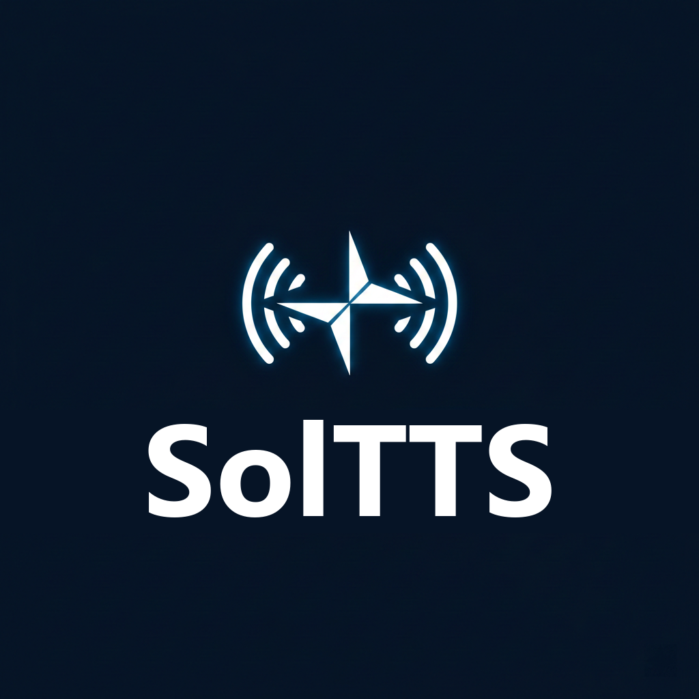

# SolTTS

<p align="center">
  
</p>

<p align="center">
  本地文本转语音，支持音色克隆、流式播放和中英 / 中日混读。<br>
  基于 ONNX Runtime 和 .NET，运行时不需要 Python。
</p>

<p align="center">
  <a href="README.md">English</a> ·
  <a href="https://github.com/YRwuhu/SolTTS/releases">下载</a>
</p>

## 使用

从 [Releases](https://github.com/YRwuhu/SolTTS/releases) 下载 Windows 压缩包，解压后保持 `resources/` 和程序在同一目录，无需安装 .NET。

运行 `sol-server.exe`，打开 <http://localhost:5000> 使用 WebUI；也可以直接用命令行：

```bash
sol-cli.exe -O out.wav -- "今天天气真好。"
```

音色管理、模型转换和参数设置都可以在 WebUI 里完成。Linux 如需模型转换，先运行 `./init-env.sh`。macOS 仅支持 V1 引擎。

默认使用 V1 引擎，支持中英、中日混读，以及实验性的[情感控制](docs/EMOTION_CONTROL.md)。V2 尚未完成，也没有随包模型。

## 构建

需要 .NET 10 SDK。

```bash
dotnet build SolTTS.sln -c Release

./publish.ps1        # Windows
./publish-linux.sh   # Linux
./publish-mac.sh     # macOS
```

配置项见 [`config.template.yaml`](config.template.yaml)。可选的 Rust 音频库有单独的[构建说明](native/sol_audio/README.md)。

## 性能

在 Ryzen 5 5500 + Radeon RX 5500 XT 上，短句合成约需 2 秒，流式播放约 0.55 秒出声，冷启动加载模型约 7 秒。

以上数据启用了并行句子解码和 GPU 声码器。测试数据、实现细节和那些没效果的尝试见 [docs/PERFORMANCE.md](docs/PERFORMANCE.md)。

## 许可证

MIT。原始作品 © 2026 Blackwood416；fork 修改 © 2026 YRwuhu。

基于 [AstraTTS](https://github.com/Blackwood416/AstraTTS)，架构和算法参考 [Genie-TTS](https://github.com/High-Logic/Genie-TTS) 与 [GPT-SoVITS](https://github.com/RVC-Boss/GPT-SoVITS)。
